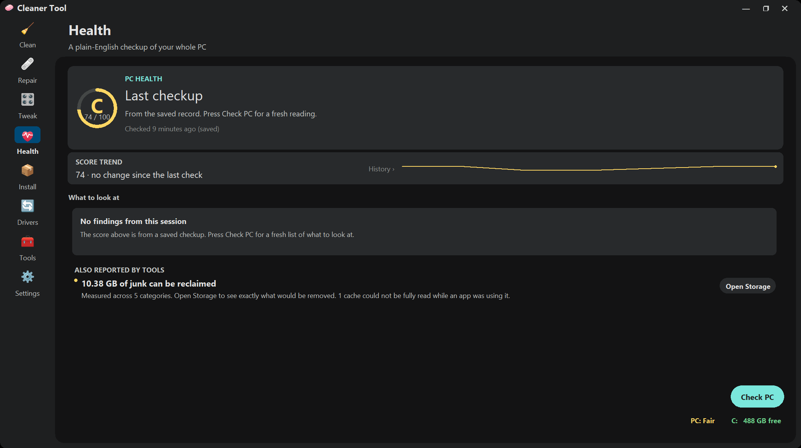

# 🧹 Cleaner Tool

**The safe, all-in-one Windows cleaner and optimizer built for gamers.**

Free up gigabytes of launcher cache, repair common Windows glitches, and apply safe, reversible gaming tweaks with a single click.

[📥 **Download Latest Release (Cleaner-Tool.exe)**](https://github.com/MyLittlePrimordia/Cleaner-Tool/releases/latest)  
*Zero install. Just download and run.*

---

## 🛡️ Safe by Design

- **Your saves are protected:** never touches game saves, personal documents, or user profiles.
- **1-Click Undo:** every tweak takes a snapshot you can restore, plus an automatic Windows restore point.
- **All recovery in one place:** a Safety & Undo panel lists restore points, applied tweaks, service changes, driver backups and quarantined files — and offers the matching undo, or says plainly when there is none.
- **Honest results:** each run reports what actually changed (disk space, memory, restart state) and says "no measurable change" when nothing did.
- **Verified updates:** the in-app updater installs a new build only after checking it against the published SHA-256, applies it on restart, and rolls back if the swap fails.
- **No unnecessary admin rights:** runs without elevation and only asks for admin when a repair actually needs it.

---

## 📸 Screenshots

<table>
  <tr>
    <td align="center" width="50%">
      <b>Clean</b><br/><br/>
      
    </td>
    <td align="center" width="50%">
      <b>Repair</b><br/><br/>
      
    </td>
  </tr>
  <tr>
    <td align="center" width="50%">
      <b>Tweak</b><br/><br/>
      
    </td>
    <td align="center" width="50%">
      <b>Install</b><br/><br/>
      
    </td>
  </tr>
  <tr>
    <td align="center" width="50%">
      <b>Drivers</b><br/><br/>
      
    </td>
    <td align="center" width="50%">
      <b>Tools</b><br/><br/>
      
    </td>
  </tr>
  <tr>
    <td align="center" width="50%"><b>Settings</b><br/><br/>
      
    </td>
    <td align="center" width="50%">
      <b>Health</b><br/><br/>
      
    </td>
  </tr>
</table>

---

## ⚡ Key Features

- 🧹 **Game & Launcher Cleaner:** clear shader caches, logs and temp files from Steam, Epic, EA, Battle.net, Riot, Discord and 25+ games. Optionally remove preinstalled Windows bloatware.
- 🩺 **1-Click Repairs:** fix corrupted system files (SFC/DISM), unstick frozen Windows Updates, repair Xbox/Game Pass services, and reset the network stack.
- 🚀 **Reversible Gaming Tweaks:** enable Ultimate Performance power mode, lower network latency, disable telemetry/ad tracking, and restore classic right-click menus.
- 📦 **Essential Runtimes:** 1-click install all the dependencies games need (DirectX, Visual C++ all-in-one, .NET, Java).
- 🩺 **PC Health:** one read-only pass across disk, memory, crash history, security, startup, drives, Windows files, junk and battery wear (on laptops), then a score and the few findings worth acting on, each with a button that opens the screen that owns the fix.
- 💾 **Driver store cleanup:** Windows keeps every earlier version of a driver you update, and never shows you where. The Drivers tab lists the ones nothing is using, exports each to your Drivers folder first, and only then removes it from the store — so an old version can always be put back.
- 🧰 **Toolbox:** storage-space breakdown, duplicate finder, startup manager (with Windows' own measured cost per entry), services, drive health, game readiness, speed and latency tests — and every measurement a tool takes shows up on the Health tab and on the Tools directory.
- 🧹 **Reclaim plan:** one ordered list across the tools — the measured categories biggest first, then the decisions that need their own scan (duplicates, unused programs, the driver store) — so "what should I do first" has an answer instead of five windows.
- 🗂️ **One Tools directory:** 19 tools grouped by job, each card carrying the tool's latest result count so you can see where to look first.
- 🛡️ **Safety & Undo Hub:** every recovery path in one popup, plus a per-run before/after that is honest about what did — and did not — change.
- 🔄 **Verified self-update:** fetch and install the new build from inside the app (checksum-checked), with the browser download kept as the fallback.
- 📈 **Past runs:** a 30-day reclaim total on the scorecard, and a list of earlier runs - each one expands to the exact values it changed and compares with the previous run of the same kind, and the list can be cleared (a confirmation says plainly that clearing it changes nothing on your PC).
- 🐞 **Support bundle:** Settings → *Logs & data* → **Create support bundle…** writes one redacted zip (diagnostics, this session's log, swallowed-failure trail, settings, the newest run, the checkup ledger, and a manifest) and shows you every file and size before saving it. Nothing is uploaded.
- ✅ **Verified results:** the number a run reports is the space the disk actually gained, measured either side of the run and capped at what the tasks removed — not a sum of file sizes that apps may have recreated. When the two disagree the card and the transcript say why (locked files, Quarantine, caches rebuilt), and the 30-day total is built from the same figure.
- 👀 **Quiet watch:** the app notices while the window is closed — a drive under your free-space threshold, a checkup that scored well below the one before it (it names the sensor that moved), or a schedule that stopped running — and says so **once**, in one notification. Thresholds live in Settings → *Quiet watch*; nothing is announced while the switch is off, and a condition has to recover before it can speak again.

---

## 🚀 Quick Start

1. Download [`Cleaner-Tool.exe`](https://github.com/MyLittlePrimordia/Cleaner-Tool/releases/latest).
2. Choose a preset (e.g. **Quick Clean** or **Recommended Tweaks**).
3. Click **Run**. That's it!

---

## 📋 Requirements

- **Windows 10 or 11**
- Python 3.10+ *(only if running from source; the `.exe` requires nothing)*

---

<details>
<summary><b>🛠️ Background Mode & Auto Maintenance</b></summary>

All background features are strictly optional:
- **System Tray:** minimize to the tray for low-disk space warnings and automatic maintenance.
- **Start with Windows:** boots silently to the tray at login with standard user rights.
- **Auto-Maintenance Scheduler:** run automated cleanups daily, weekly, or monthly.
- **Tweak Exception Note:** the optional advanced tweak *"No Explorer Auto Discovery"* clears per-folder view caches (`Bags/BagMRU`), which rebuild naturally as you browse rather than restoring previous view layouts. All other tweaks are 100% fully reversible.
</details>

<details>
<summary><b>💻 Running from Source & Building</b></summary>

### Run from Source
```powershell
python main.py
```

### Build Standalone `.exe`
```powershell
pip install -r requirements.txt
pyinstaller --onefile --windowed --name "Cleaner-Tool" --icon "app/assets/icon.ico" --add-data "app/assets;app/assets" --manifest "app/assets/app_manifest.xml" --version-file "version_info.txt" app/__main__.py
```

### Run Tests
```powershell
pip install -r requirements-dev.txt
python -m pytest -q
python -m ruff check app dev --select F # pyflakes defects (CI gate)
python dev/tools/design_literals.py                 # no widget writes a raw size
python dev/tools/verify_sec001_task_allowlist.py   # SEC-001 task-allowlist drift guard
python dev/tools/verify_powershell_single_call_site.py  # one PowerShell call site
python dev/tools/verify_dryrun_scope.py            # a dry-run scan never deletes
```
The suite is stdlib-only and runs on Windows; `pytest` and `ruff` are
dev-only tools (not listed in `requirements.txt`, which covers the runtime +
PyInstaller build). All six commands run in CI on every push. See
[CONTRIBUTING.md](CONTRIBUTING.md) for what the guards check and how to add one.

### Headless / Automation
```powershell
python main.py --plan --json     # read-only: what a Clean would reclaim (JSON)
python main.py --auto-clean         # run the saved Clean/Repair selection now
```
`--plan` measures the selected Clean tasks with the same code a real run
uses and changes nothing; add `--json` for a machine-readable report.
(`--dry-run` is still accepted as an alias.) In the app the same read-only
measurement is called **Preview**, so the two names never describe different
behaviour again.

On every push to `main`, `.github/workflows/build.yml` runs the suite and
builds `Cleaner-Tool.exe`, overwriting the rolling `latest` release (a version
tag like `v2.1.0` also cuts its own release). Verify any download against the
published `Cleaner-Tool.exe.sha256`.

### Code signing

Release builds are signed with **SSL.com eSigner**, which keeps the private key
in a cloud HSM. Four repository secrets enable it — `ES_USERNAME`,
`ES_PASSWORD`, `ES_CREDENTIAL_ID` (printed by CodeSignTool's
`get_credential_ids`) and `ES_TOTP_SECRET` (the base32 seed behind the eSigner
OTP, which is what lets signing run unattended). Nothing is exported or
downloaded: the workflow sends the file's hash and gets signed bytes back.

A `.pfx` in a repository secret is **not** an option for a newly issued
certificate. Since 2023-06-01 the CA/Browser Forum requires a publicly trusted
code-signing key to be generated, stored and used inside qualifying hardware,
so cloud HSM custody is the supported model and the workflow checks that the
retired `.pfx` path never comes back.

With the secrets absent the build still succeeds and emits an `Unsigned build`
warning. With them present, signing runs on `push` and `workflow_dispatch` only
(never on a pull request, which would spend a signature on reviewable code),
and a verification step fails the job unless the result is `Valid` **and**
timestamped — an untimestamped signature stops verifying when the certificate
expires, including for copies already downloaded.

Signing is necessary but not sufficient for SmartScreen: reputation accrues
per publisher and per file over weeks of clean installs, and EV no longer
bypasses the warning. Submitting the first signed build to
[Microsoft's file submission portal](https://www.microsoft.com/wdsi/filesubmission)
helps that along.
</details>
