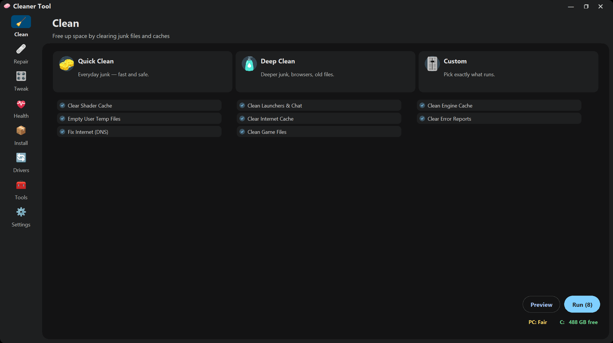
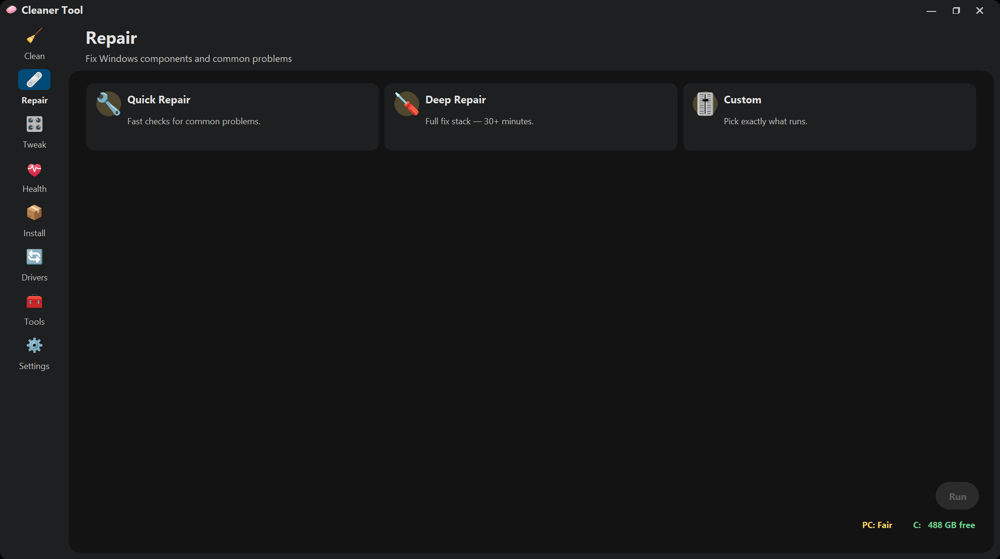
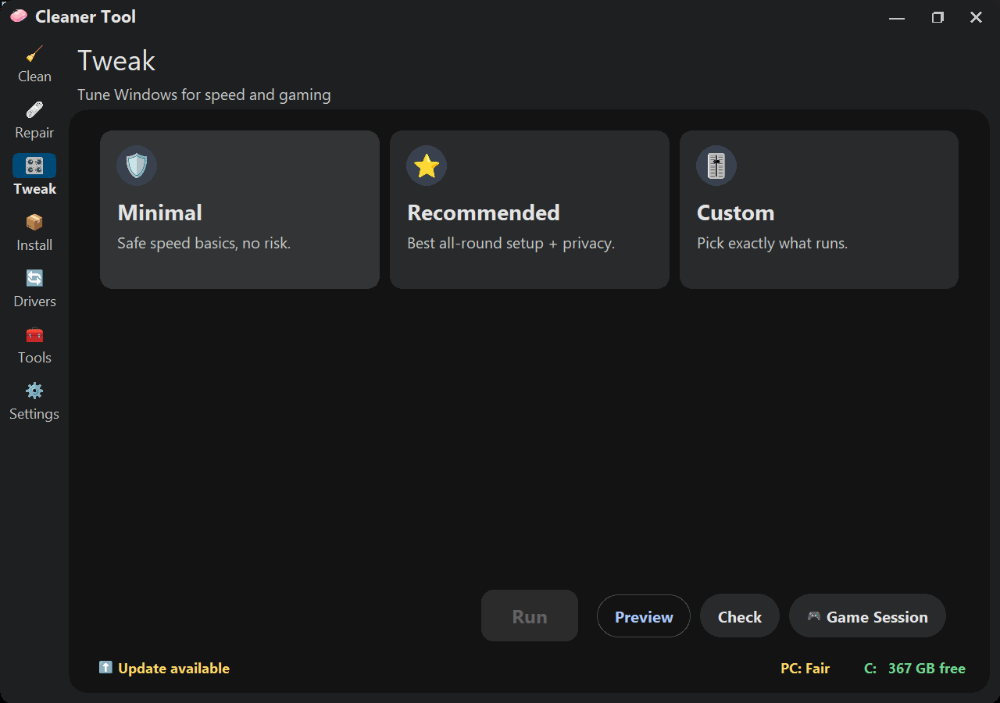
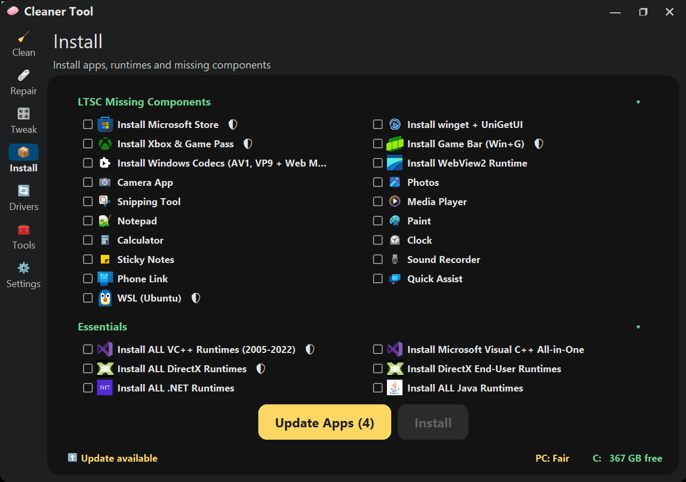
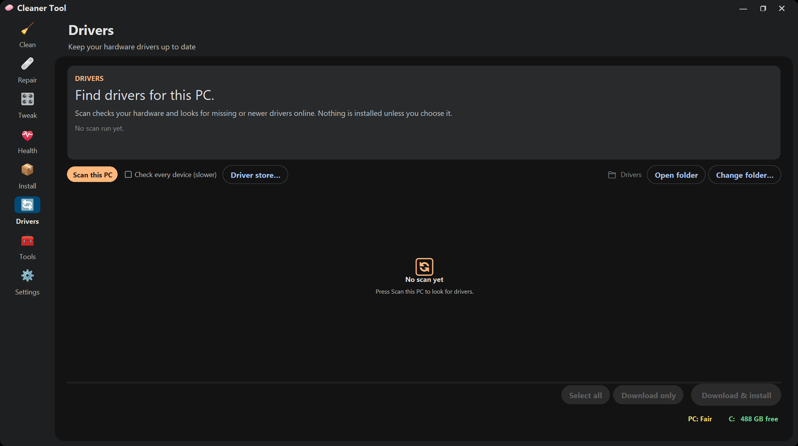
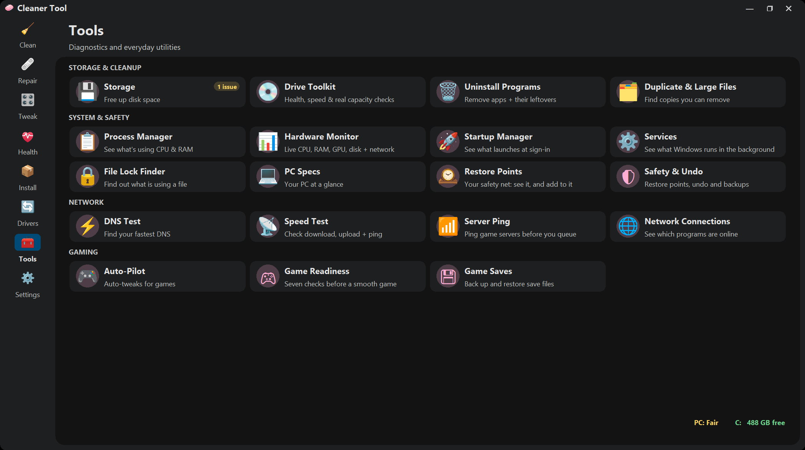
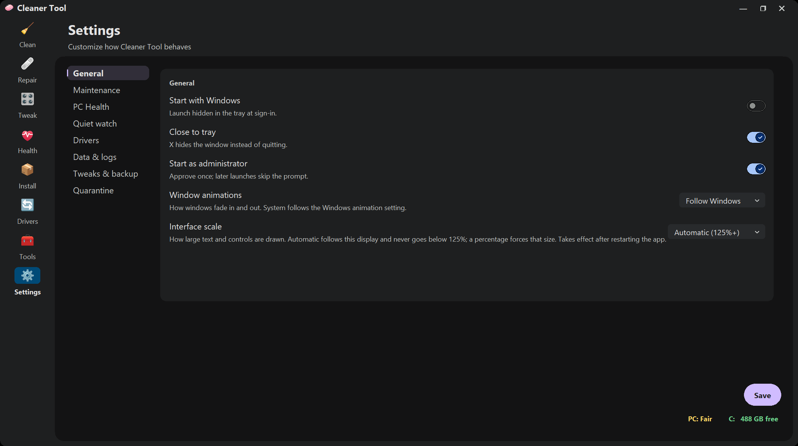

# 🧹 Cleaner Tool

**The safe, all-in-one Windows cleaner and optimizer built for gamers.**

Free up gigabytes of launcher cache, repair common Windows glitches, and apply safe, reversible gaming tweaks with a single click.

[📥 **Download Latest Release (Cleaner-Tool.exe)**](https://github.com/MyLittlePrimordia/Cleaner-Tool/releases/latest)  
*Zero install. Just download and run.*

---

## 🛡️ Safe by Design

- **Your saves are protected:** never touches game saves, personal documents, or user profiles.
- **1-Click Undo:** every tweak takes a snapshot you can restore, plus an automatic Windows restore point.
- **All recovery in one place:** a Safety & Undo panel lists restore points, applied tweaks, service changes, driver backups and quarantined files — and offers the matching undo, or says plainly when there is none.
- **Honest results:** each run reports what actually changed (disk space, memory, restart state) and says "no measurable change" when nothing did.
- **Verified updates:** the in-app updater installs a new build only after checking it against the published SHA-256, applies it on restart, and rolls back if the swap fails.
- **No unnecessary admin rights:** runs without elevation and only asks for admin when a repair actually needs it.

---

## 📸 Screenshots

<table>
  <tr>
    <td align="center" width="50%">
      <b>Clean</b><br/><br/>
      
    </td>
    <td align="center" width="50%">
      <b>Repair</b><br/><br/>
      
    </td>
  </tr>
  <tr>
    <td align="center" width="50%">
      <b>Tweak</b><br/><br/>
      
    </td>
    <td align="center" width="50%">
      <b>Install</b><br/><br/>
      
    </td>
  </tr>
  <tr>
    <td align="center" width="50%">
      <b>Drivers</b><br/><br/>
      
    </td>
    <td align="center" width="50%">
      <b>Tools</b><br/><br/>
      
    </td>
  </tr>
  <tr>
    <td align="center" width="50%">
      <b>Settings</b><br/><br/>
      
    </td>
    <td align="center" width="50%"></td>
  </tr>
</table>

---

## ⚡ Key Features

- 🧹 **Game & Launcher Cleaner:** clear shader caches, logs and temp files from Steam, Epic, EA, Battle.net, Riot, Discord and 25+ games. Optionally remove preinstalled Windows bloatware.
- 🩺 **1-Click Repairs:** fix corrupted system files (SFC/DISM), unstick frozen Windows Updates, repair Xbox/Game Pass services, and reset the network stack.
- 🚀 **Reversible Gaming Tweaks:** enable Ultimate Performance power mode, lower network latency, disable telemetry/ad tracking, and restore classic right-click menus.
- 📦 **Essential Runtimes:** 1-click install all the dependencies games need (DirectX, Visual C++ all-in-one, .NET, Java).
- 🧰 **Gamer Toolbox:** built-in controller tester, live microphone test, internet speed test, and storage space visualizer.
- 🛡️ **Safety & Undo Hub:** every recovery path in one popup, plus a per-run before/after that is honest about what did — and did not — change.
- 🔄 **Verified self-update:** fetch and install the new build from inside the app (checksum-checked), with the browser download kept as the fallback.
- 📈 **Run history & trends:** a running total of what cleaning has reclaimed, a 30-day sparkline, and the most recent runs.

---

## 🚀 Quick Start

1. Download [`Cleaner-Tool.exe`](https://github.com/MyLittlePrimordia/Cleaner-Tool/releases/latest).
2. Choose a preset (e.g. **Quick Clean** or **Recommended Tweaks**).
3. Click **Run**. That's it!

---

## 📋 Requirements

- **Windows 10 or 11**
- Python 3.10+ *(only if running from source; the `.exe` requires nothing)*

---

<details>
<summary><b>🛠️ Background Mode & Auto Maintenance</b></summary>

All background features are strictly optional:
- **System Tray:** minimize to the tray for low-disk space warnings and automatic maintenance.
- **Start with Windows:** boots silently to the tray at login with standard user rights.
- **Auto-Maintenance Scheduler:** run automated cleanups daily, weekly, or monthly.
- **Tweak Exception Note:** the optional advanced tweak *"No Explorer Auto Discovery"* clears per-folder view caches (`Bags/BagMRU`), which rebuild naturally as you browse rather than restoring previous view layouts. All other tweaks are 100% fully reversible.
</details>

<details>
<summary><b>💻 Running from Source & Building</b></summary>

### Run from Source
```powershell
python main.py
```

### Build Standalone `.exe`
```powershell
pip install -r requirements.txt
pyinstaller --onefile --windowed --name "Cleaner-Tool" --icon "app/assets/icon.ico" --add-data "app/assets;app/assets" --manifest "app/assets/app_manifest.xml" --version-file "version_info.txt" app/__main__.py
```

### Run Tests
```powershell
python -m pytest -q
python tools/verify_sec001_task_allowlist.py   # SEC-001 task-allowlist drift guard
```
The suite is stdlib-only and runs on Windows; `pytest` is a dev-only tool
(not listed in `requirements.txt`, which covers the runtime + PyInstaller build).

### Headless / Automation
```powershell
python main.py --dry-run --json     # read-only: what a Clean would reclaim (JSON)
python main.py --auto-clean         # run the saved Clean/Repair selection now
```
`--dry-run` measures the selected Clean tasks with the same code a real run
uses and changes nothing; add `--json` for a machine-readable report.

On every push to `main`, `.github/workflows/build.yml` runs the suite and
builds `Cleaner-Tool.exe`, overwriting the rolling `latest` release (a version
tag like `v2.1.0` also cuts its own release). Verify any download against the
published `Cleaner-Tool.exe.sha256`.
</details>
